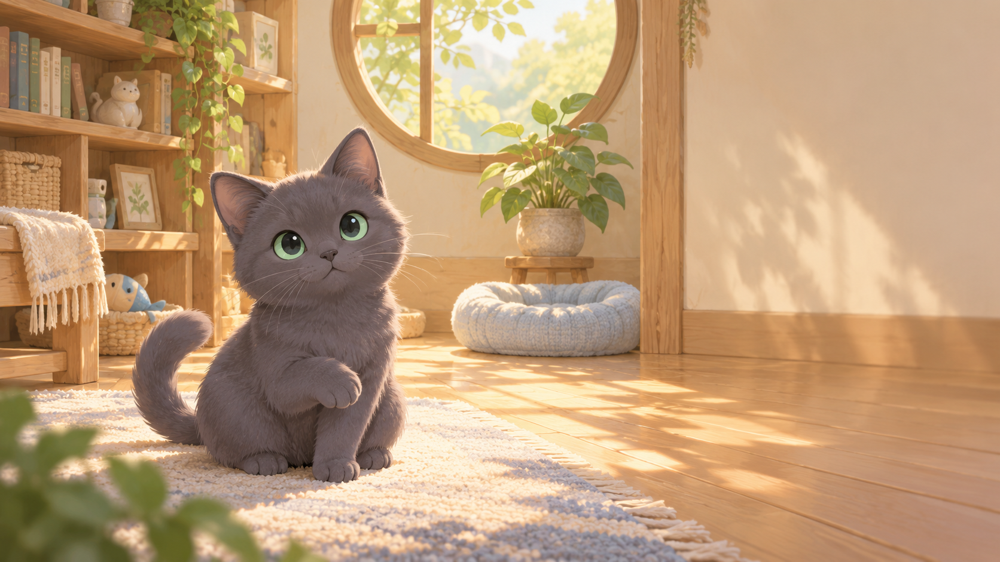

# 喵屋 CatGame

**摸摸猫，攒点猫毛，陪它们慢慢长成一个热闹的家。**

《喵屋》是一款可以直接下载游玩的2D养猫放置游戏Demo。猫咪会在等距小屋里漫游、打盹，被摸到时跳一下；你可以收集猫毛，迎接新伙伴、购买用品，再慢慢解锁成就与剧情。

支持 **Windows x64** 和 **Android ARM64横屏**，核心玩法离线运行。

[下载 v1.1.0 · Windows / Android](https://github.com/Creepercao/CatGame/releases/tag/v1.1.0)

*主菜单插画。游戏内采用像素猫咪与等距房间，剧情使用独立CG插画。*

## 在小屋里做些什么

- **摸摸猫咪：**点击猫咪获得猫毛；睡着的猫会被唤醒并跳跃，之后继续漫游。
- **迎接新伙伴：**攒够猫毛后购买猫咪，目前有11种猫咪可以收集。
- **布置与成长：**购买、升级用品来增强产出，让资源积累得更快。
- **轻松放置：**猫咪自行活动也会产生猫毛；离开游戏再回来，可以领取按50%收益计算、最多8小时的离线收益。
- **收集成就与故事：**达成目标后解锁成就和对应CG，随时在设置界面查看猫咪图鉴与成就进度。
- **准备一次出发：**后期购买火箭可触发结局，查看游玩统计；结局后可以继续留在小屋，也可以回到主菜单。

## 怎么操作

| 操作 | Windows | Android |
| --- | --- | --- |
| 摸猫、选择菜单 | 鼠标左键点击 | 手指点击 |
| 浏览伙伴与用品 | 切换伙伴/用品并滚动 | 切换伙伴/用品并滑动 |
| 继续观看CG后的游戏 | 点击CG画面任意位置 | 轻触CG画面任意位置 |
| 设置、图鉴与成就 | 点击左上功能栏的“设置” | 点击左上功能栏的“设置” |

首次新建存档时，第一只猫会通过对话介绍玩法。设置中的音量与数字显示方式会在主菜单和游戏内共用；Windows还可调整窗口分辨率。

## 下载与运行

### Windows

1. 在[v1.1.0发行页面](https://github.com/Creepercao/CatGame/releases/tag/v1.1.0)下载 `CatGame-Windows-x64-v1.1.0.zip`。
2. **完整解压**，保留 `CatGame_Data`、`UnityPlayer.dll` 和 `MonoBleedingEdge` 等配套文件。
3. 双击 `CatGame.exe` 开始游玩，无需安装Unity或Python。

ZIP内附有可选的外置修改器 `Debugger/CatGameDebugger.exe`。进入正常游戏后启动，它会自动连接；可用来调整运行中的资源与猫咪数量，修改结果由游戏正常保存。

### Android

1. 在同一个发行页面下载 `CatGame-Android.apk`。
2. 按手机提示允许当前浏览器或文件管理器安装应用，然后安装APK。
3. 打开“喵屋”，横屏游玩。

更新已有版本时直接覆盖安装即可保留进度。安装说明和 `SHA256SUMS.txt` 与Windows、Android安装包一起提供。

## 存档与继续游戏

游戏会自动保存，也会在成功购买、切后台和正常退出时保存。再次启动后选择“继续游戏”即可回到原来的小屋。

- **Windows存档：**`%USERPROFILE%/AppData/LocalLow/CatGameStudio/喵屋/`。
- **Android存档：**保存在应用本地数据中；卸载应用可能清除进度，更新时请使用覆盖安装。
- **备份恢复：**主存档缺失或损坏时会尝试读取上一份备份，可能回退最近一轮保存后的进度。

## 当前Demo

当前发行版为 **v1.1.0**，Windows和Android位于同一个Release。包含猫窝、猫咪收集与用品升级、首次引导、成就CG、火箭结局、离线收益和存档恢复。

本版统一了猫咪、房间及用品的尺寸和落脚关系，并调整世界画面的像素显示。不同窗口尺寸下会优先保留完整取景，文字、界面和CG使用独立显示方式。

欢迎反馈游玩问题。提交[Issue](https://github.com/Creepercao/CatGame/issues)时，可以附上游戏版本、设备与系统、发生步骤及截图，方便复现。

## 关于制作

个人游戏Demo，使用 **Unity 2022.3.21f1 / C#** 开发，部分设计、代码与素材制作使用AI辅助。

想查看或修改源码，可以用对应版本Unity打开仓库，加载 `Assets/Scenes/MainMenu.unity` 后进入Play模式。

游戏的自动化测试与运行证据单独保存在[CatGame-test-evidence](https://github.com/Creepercao/CatGame-test-evidence)。

仓库未声明统一开源许可证，第三方素材权利归原作者；Android中文字体Noto Sans SC附带SIL Open Font License。
